# Rolevisor

**Tailor your resume to every job you apply for.** Rolevisor reads your resume and a job posting, then rewrites your resume for that job, writes a cover letter, scores your keywords before and after, and tells you what to fix first. It's built for anyone in the middle of a job search, technical or not.

**Try it:** [rolevisor.vercel.app](https://rolevisor.vercel.app) · [See an example](https://rolevisor.vercel.app/example) (no key needed)

No account and no subscription. You pick where the AI runs:

- **Claude** (Anthropic's AI): best results, nothing to install. You bring your own API key, billed to your own Anthropic account (about 1 to 3 cents per tailored resume).
- **A free local model** through **LM Studio** or **Ollama**: runs on your own computer, so your resume never leaves it.
- **No model at all**: the keyword score, formatting checks, bullet check, clean resume templates, and application log all work for free.

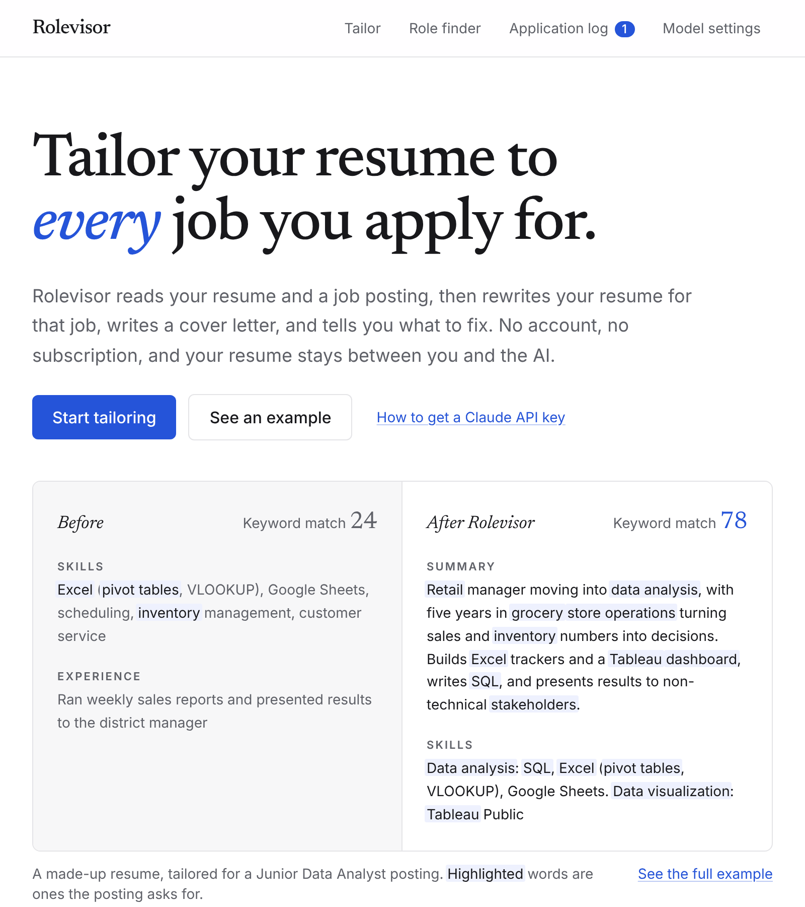

## What it does

| | Feature | Needs a model? |
|---|---|---|
| ✍️ | **Tailored resume**: rewrites your resume for one posting, with an AI fit score, the skills you have and are missing, and a list of what changed and why | Yes |
| 🎯 | **Keyword match score**: the skills, tools, and credentials the posting asks for, weighted like an applicant tracking system, before and after tailoring. Flags any new words you should double-check are true | No |
| ✉️ | **Cover letter**: written for the job, downloadable as PDF or Word | Yes |
| 💡 | **Suggestions**: advice for this application, most useful first | Yes |
| 📐 | **Formatting and bullet checks**: length, sections, dates, contact details, weak bullet openers, missing numbers, and whether LinkedIn or GitHub links would help | No |
| 📄 | **Clean templates**: your resume, word for word, in a Classic or Modern PDF or Word layout | No |
| 🔗 | **Job links**: paste a Greenhouse, Lever, Ashby, LinkedIn, or company careers link and Rolevisor reads the posting. Screenshots of postings work too | No |
| ⚡ | **Get everything**: one click makes the tailored resume, cover letter, and advice, then gives you one zip named after the company | Yes |
| 🧭 | **Role finder**: suggests roles that fit your background, with search links to the big job boards | Yes |
| 🗂️ | **Application log**: tracks where you applied, what you sent, and when to follow up, with CSV and JSON export | No |
| 🌗 | **Light and dark themes**, and a layout that works on a phone | |

## Screenshots

All taken from the built-in [example](https://rolevisor.vercel.app/example), which uses a made-up resume for "Sam" and a made-up posting.

### Keyword score, before and after

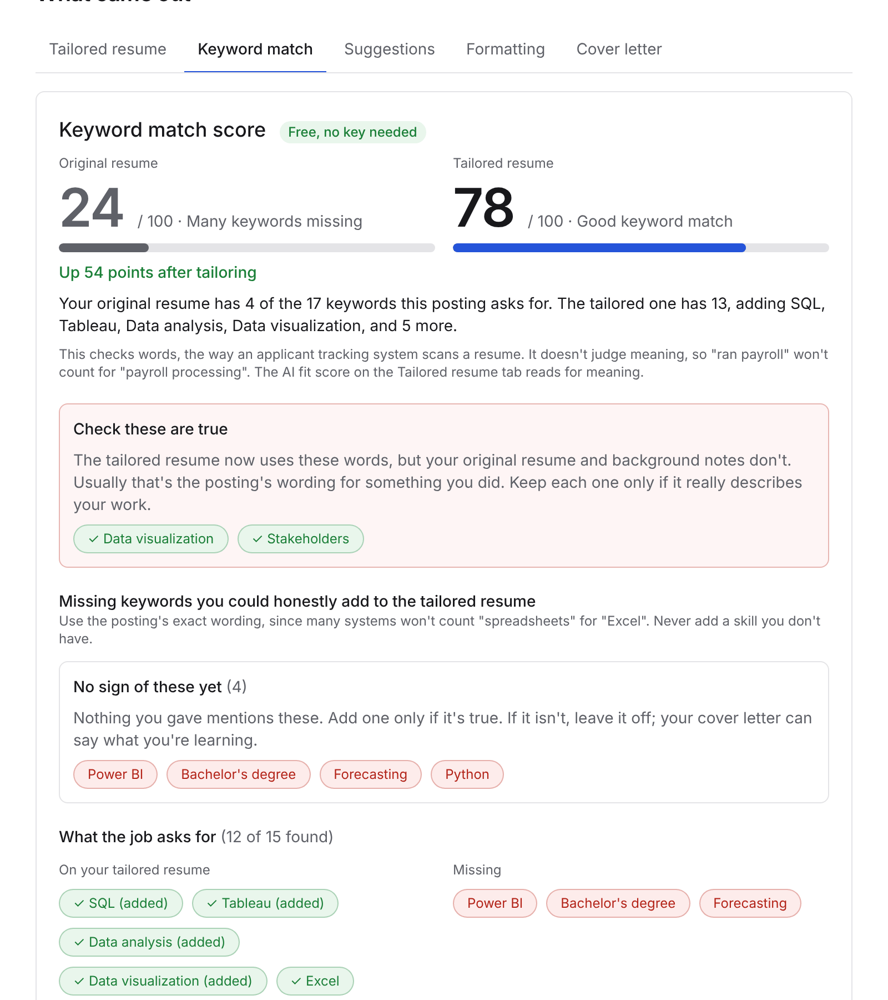

### Tailored resume

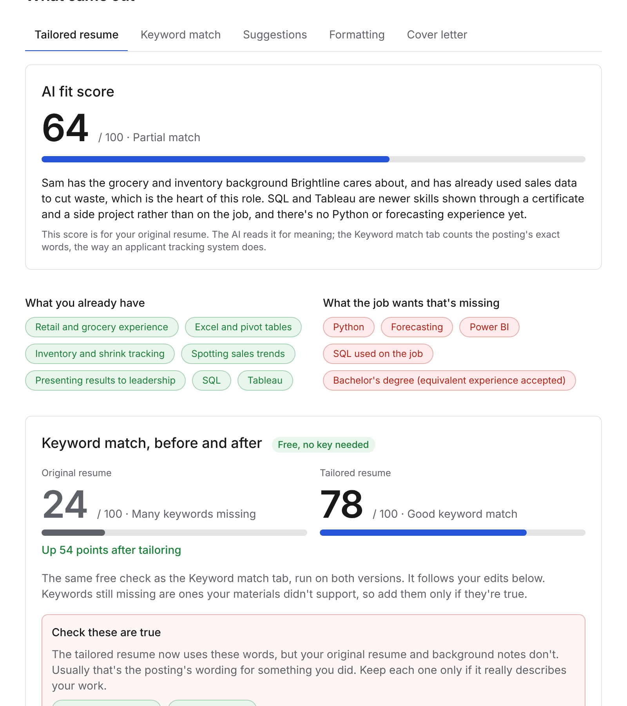

### Cover letter

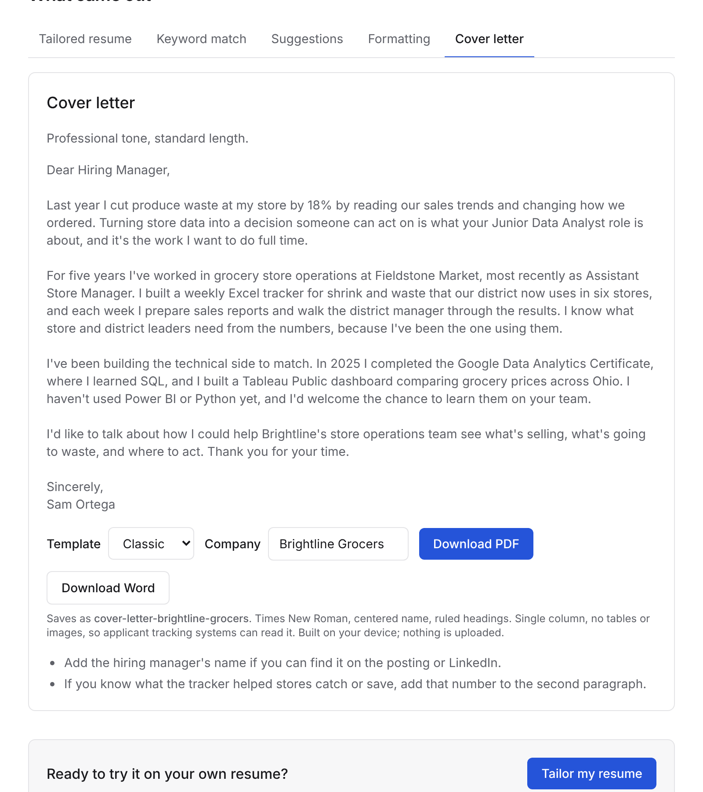

<b>More screenshots</b>: suggestions, formatting checks, application log, settings, dark mode, and phone

### Suggestions

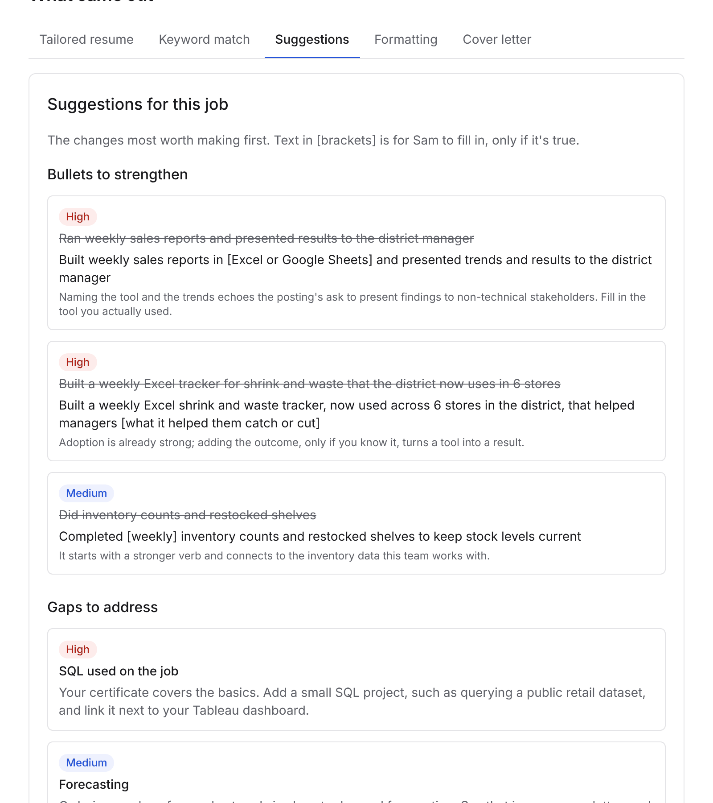

### Formatting checks

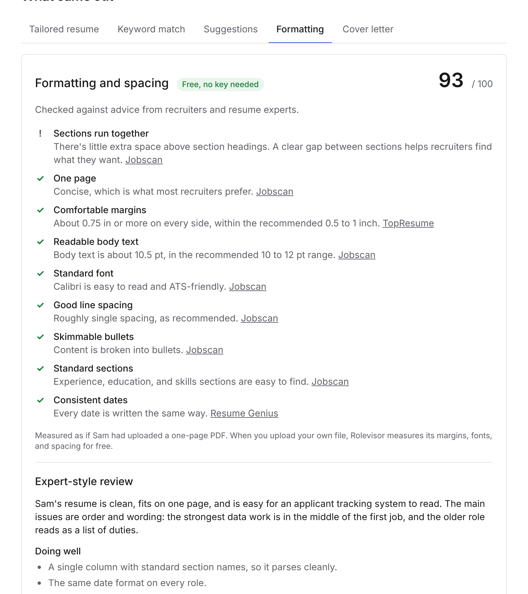

### Application log

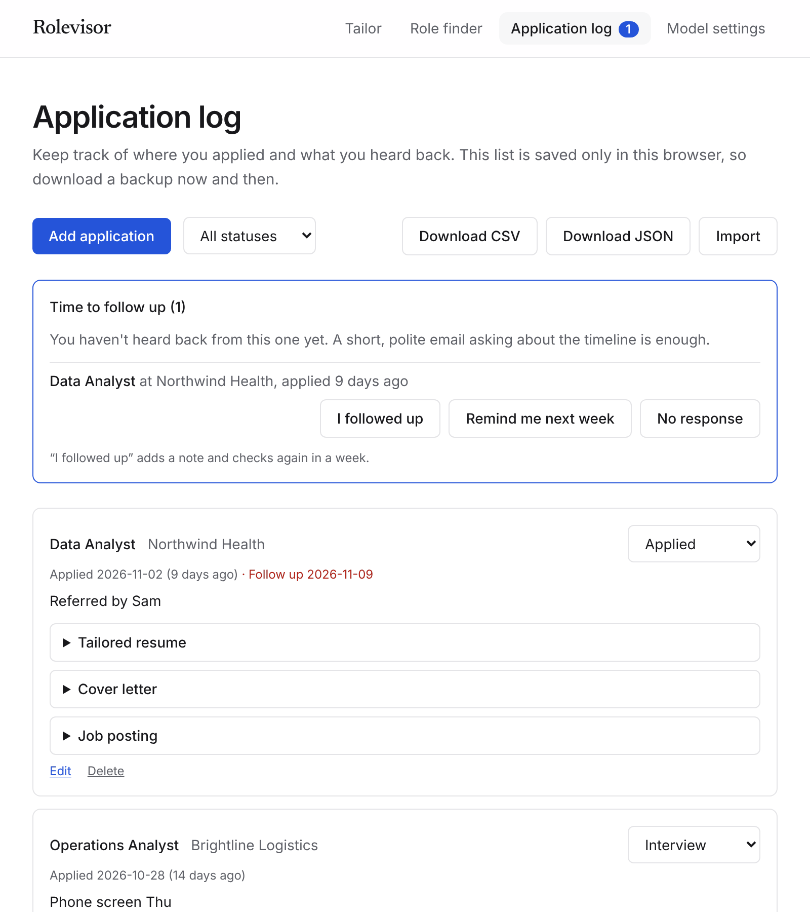

### Tailor page

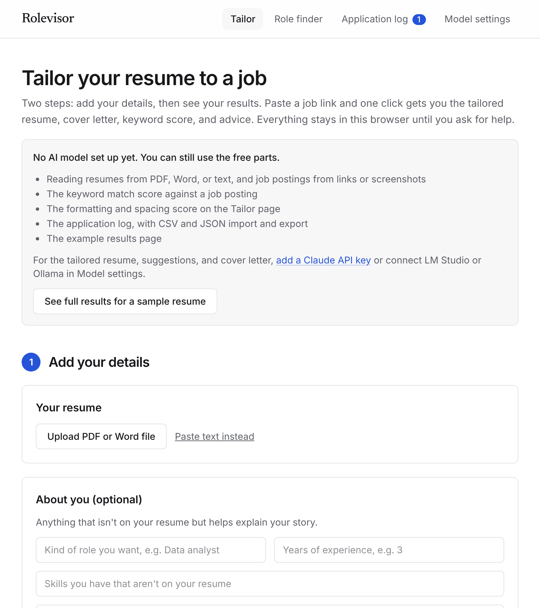

### Model settings

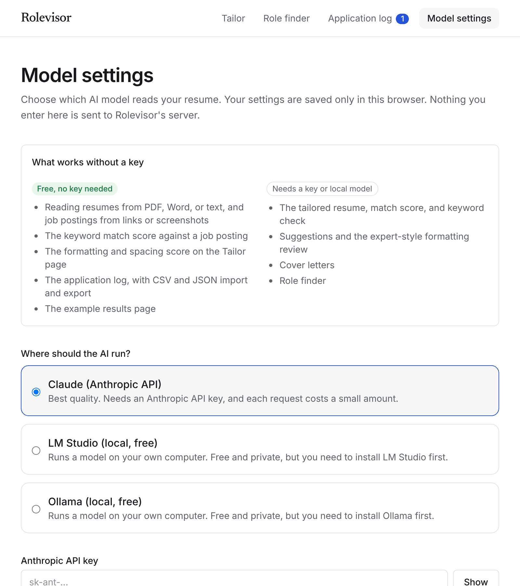

### Dark mode

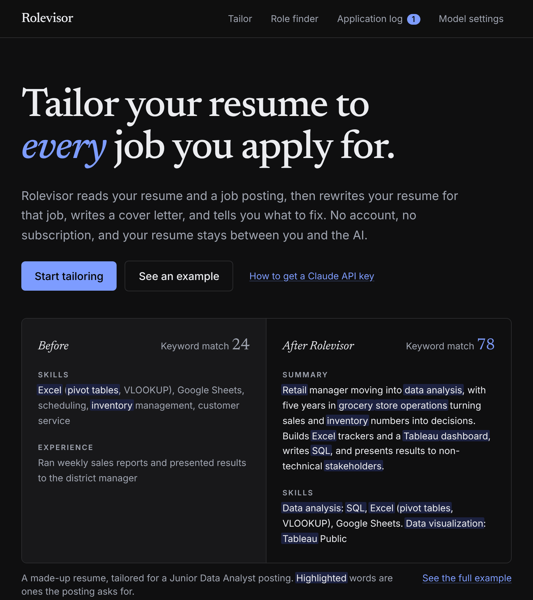

### On a phone

  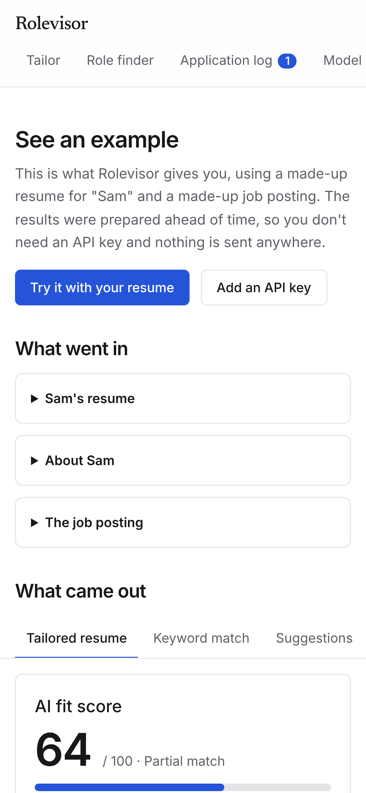
  &nbsp;
  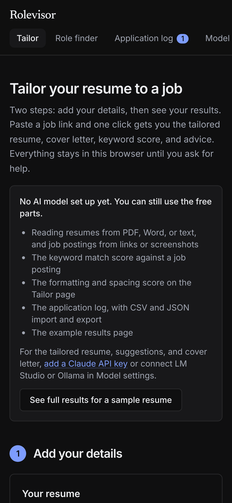

## Using Rolevisor

1. Open [rolevisor.vercel.app](https://rolevisor.vercel.app). There's nothing to install. Click **Start tailoring**.
2. Click **Model settings** and pick where the AI runs:
   - **Claude:** paste an API key from [console.anthropic.com](https://console.anthropic.com), then click **Test connection**. New to API keys? Follow the [step-by-step guide](https://rolevisor.vercel.app/guide/api-key).
   - **LM Studio or Ollama:** follow the [local model setup guide](docs/local-models.md), then click **Test connection**.
   - **Skipping the model?** You can still use everything marked "Free, no key needed".
3. On **Tailor**, add your resume (PDF, Word, text, or paste) and the job posting (a link, the text, or a screenshot), then click **Get everything**. You'll get a summary with the keyword score before and after, the advice worth doing first, and one zip with the resume and cover letter as PDF and Word. Untick "Also write the cover letter and advice" to only tailor the resume. With Claude the three run at the same time; a local model does them one after another.
4. Applying? Click **Save to log**. The **Application log** keeps the company, date, status, what you sent, and the posting, and reminds you to follow up after a week. **Add to calendar** puts the reminder in your own calendar.
5. Not sure what to apply for? Open **Role finder**.

Indeed, Glassdoor, and some LinkedIn pages block link reading, so paste the text or a screenshot for those. If something isn't set up right, **Test connection** tells you what to fix in plain English.

## Privacy

- Your resume, background, settings, and application log are saved only in your own browser. Download a backup of the log now and then.
- Resume files are read inside your browser and never uploaded.
- With LM Studio or Ollama, your browser talks straight to the model on your computer.
- With Claude, your browser sends your resume and API key straight to Anthropic's API. They never pass through the Rolevisor server, which stores and logs nothing. The key is kept for the current tab only unless you tick "Remember my key on this device".
- A pasted job link is read by the Rolevisor server. Only the link goes there, and nothing is saved.

## How Claude models are used

Claude has two model settings so the expensive model is only used when it's worth it:

- **Model for big jobs** (default: Claude Sonnet): rewriting your whole resume and cover letters. Switch to Opus in Model settings for the most capable (and priciest) results.
- **Model for quick jobs** (default: Claude Haiku): lighter work like short suggestions.

Local models use the one model you pick for everything.

## Docs

- [Use a free local model](docs/local-models.md): LM Studio and Ollama setup, and which model fits your computer.
- [Development and hosting](docs/development.md): running it locally, how the code fits together, deploying to Vercel, and retaking these screenshots.
